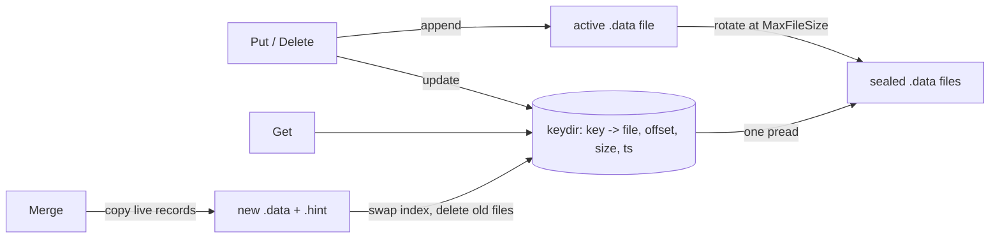

# caskdb

A small, embeddable, log-structured key/value store for Go, modelled on
[Bitcask](https://riak.com/assets/bitcask-intro.pdf), plus a Redis-protocol
server so `redis-cli` and ordinary Redis clients can talk to it.

- Append-only data files with CRC32-checked records
- In-memory hash index ("keydir"): one disk read per `Get`
- Automatic file rotation and torn-write recovery after a crash
- Online compaction (`Merge`) that runs alongside reads and writes, writes
  hint files for fast startup, and is crash safe
- Per-key expiry (TTL) with millisecond resolution, persisted in the log,
  dropped by merge, with optional background sweeping
- Concurrent-safe `*DB` handle, advisory directory lock on Unix
- Zero dependencies outside the standard library

## Install

```sh
go get github.com/avohra25/caskdb          # library
go install github.com/avohra25/caskdb/cmd/caskdb@latest   # CLI and server
```

## Library

```go
db, err := caskdb.Open("./data", &caskdb.Options{SyncOnPut: false})
if err != nil {
	log.Fatal(err)
}
defer db.Close()

db.Put([]byte("user:1"), []byte("ada"))

v, err := db.Get([]byte("user:1"))   // "ada"
_, err = db.Get([]byte("nope"))      // caskdb.ErrNotFound

db.Delete([]byte("user:1"))
db.Keys()                            // sorted live keys
db.Fold(func(k, v []byte) error { return nil })
db.Merge()                           // reclaim space from overwritten/deleted data
db.Stats()                           // keys, files, disk vs live bytes
```

| Option | Default | Meaning |
|---|---|---|
| `MaxFileSize` | 64 MiB | Rotate the active data file once it would exceed this size |
| `SyncOnPut` | `false` | `fsync` after every write. Otherwise data is durable after `Sync`, `Close` or rotation |
| `SweepInterval` | `0` (off) | Drop expired keys from the in-memory index this often |
| `Now` | `time.Now` | Wall clock used for expiry; swap it out in tests |

Keys are 1 byte to 64 KiB and values up to 64 MiB; both are arbitrary bytes.

### Key expiry

```go
db.PutWithTTL([]byte("session:42"), token, 30*time.Minute)
db.PutWithExpiry([]byte("promo"), data, time.Date(2026, 12, 1, 0, 0, 0, 0, time.UTC))

db.TTL([]byte("session:42"))              // 29m59.98s; caskdb.NoTTL if permanent
db.ExpiresAt([]byte("session:42"))        // absolute time; zero Time if permanent
db.Expire([]byte("user:1"), time.Hour)    // add or change a TTL on an existing key
db.Persist([]byte("session:42"))          // make it permanent again
db.SweepExpired()                         // free index memory held by expired keys
```

Expired keys behave exactly like deleted ones: `Get` returns `ErrNotFound`
and they vanish from `Has`, `Len`, `Keys`, `Fold` and `Stats`. A plain `Put`
clears any TTL (as in Redis), and an expiry that is already in the past
deletes the key. Expiry is stored in the data record itself, so it survives
restarts and merges, and a key that expired while the database was closed is
gone when it reopens.

Expired records are reclaimed by `Merge`. Deleting an expired key writes no
tombstone, because the expired record already hides every older version.
Merge can drop an expired record outright for the same reason: all older
versions of the key live in the sealed files that the merge replaces.

## Server and CLI

```sh
$ caskdb serve -dir ./data -addr 127.0.0.1:6380 &
$ redis-cli -p 6380 SET greeting hello
OK
$ redis-cli -p 6380 GET greeting
"hello"
$ redis-cli -p 6380 KEYS 'gr*'
1) "greeting"
```

Supported commands: `PING`, `ECHO`, `GET`, `SET`, `SETEX`, `PSETEX`, `DEL`,
`EXISTS`, `EXPIRE`, `PEXPIRE`, `EXPIREAT`, `PEXPIREAT`, `TTL`, `PTTL`,
`EXPIRETIME`, `PEXPIRETIME`, `PERSIST`, `KEYS` (glob patterns), `DBSIZE`,
`MERGE`, `INFO`, `QUIT`.

`SET` takes the Redis options `NX`, `XX`, `GET`, `EX`, `PX`, `EXAT`, `PXAT`
and `KEEPTTL`, and the `EXPIRE` family takes `NX`, `XX`, `GT` and `LT`.
Replies follow Redis 7, including `-2`/`-1` from `TTL` for missing and
permanent keys. Conditional commands are atomic across clients, so
`SET lock token NX PX 30000` works as a simple lock:

```sh
$ redis-cli -p 6380 SET lock worker-1 NX PX 30000
OK
$ redis-cli -p 6380 SET lock worker-2 NX PX 30000
(nil)
$ redis-cli -p 6380 PTTL lock
(integer) 29874
```

`caskdb serve` sweeps expired keys from memory once a minute
(`-sweep 0` turns that off). Both RESP arrays and inline
commands (`printf 'GET greeting\r\n' | nc localhost 6380`) work, and pipelined
commands are answered in a single write.

The CLI also works directly on a directory (stop the server first, because
the directory is locked):

```sh
caskdb put -dir ./data name caskdb
echo "from stdin" | caskdb put -dir ./data piped
caskdb get -dir ./data name
caskdb put -dir ./data -ttl 10m session abc
caskdb ttl -dir ./data session                 # 9m58.204s
caskdb expire -dir ./data name 24h
caskdb persist -dir ./data name
caskdb keys -dir ./data
caskdb del -dir ./data name
caskdb merge -dir ./data
caskdb stats -dir ./data
```

## How it works



**Writes** are encoded as a record and appended to the active file, then the
keydir entry for that key is pointed at the new record. A `Delete` appends a
tombstone record. The active file is rotated once it would exceed
`MaxFileSize`.

**Reads** look the key up in the keydir and issue a single `ReadAt` for
exactly the record's bytes, then verify the checksum and the key.

**Startup** scans every data file (or its hint file, when present) to rebuild
the keydir. Each record carries a logical timestamp, and conflicts are
resolved by timestamp rather than file order, which is what lets merge output
files be numbered after the active file without newer writes losing out.
If the newest file ends in a partial record (a crash mid-append), the tail is
truncated and appends resume on a clean boundary. Corruption anywhere else is
reported as `ErrCorrupt` rather than silently skipped.

**Merge** seals the active file, snapshots the keydir entries that point at
sealed files, and copies those records into new files without holding the
lock, so reads and writes carry on. Each output gets a hint file listing
`(key, ts, offset, size)`. Outputs are written under `.tmp` names, fsynced and
renamed into place. A `MERGE_MANIFEST` listing the obsolete files is then
committed, the keydir is swapped under the write lock (only for keys that were
not overwritten meanwhile), and the old files are deleted. If the process dies
before the manifest exists, the merge never happened; if it dies after, the
next `Open` finishes the deletions. This ordering matters because dropping a
tombstone while a value it shadows survives would resurrect a deleted key.

### File formats

Data record (little endian):

| Field | Size | Notes |
|---|---|---|
| crc32 | 4 | IEEE checksum of everything after this field |
| ts | 8 | logical timestamp, monotonic per database |
| flags | 1 | bit 0 = tombstone, bit 1 = has expiry |
| ksize | 4 | |
| vsize | 4 | value length, plus 8 when bit 1 is set |
| key | ksize | |
| expiry | 8 | unix milliseconds, only when bit 1 is set |
| value | vsize | |

Hint entry: `crc32(4) ts(8) offset(8) size(4) ksize(4) key [expiry(8)]`,
where the high bit of `ksize` marks an expiry. A damaged hint file is ignored
and the data file is scanned instead. Files written before expiry support
never set either bit, so existing databases open unchanged.

## Benchmarks

`go test -bench . ./` on an 8-vCPU Intel Xeon cloud VM (Go 1.27, ext4):

| Benchmark | Result |
|---|---|
| Put, 128 B values | 1.6 µs/op (78 MB/s) |
| Put, 4 KiB values | 7.6 µs/op (540 MB/s) |
| Put with `SyncOnPut` | 90 µs/op |
| Get, random key of 100k | 0.80 µs/op |
| Get, parallel (8 goroutines) | 0.26 µs/op |
| Open 50k keys, unmerged | 42 ms |
| Open 50k keys, merged (hint files) | 13 ms |

## Limitations

- Every live key, plus a small fixed-size index entry, is held in memory.
- One process per directory; it is not replicated or distributed.
- No range scans beyond sorted `Keys()`; this is a hash index, not a tree.
- Expiry follows the wall clock. Moving the clock forward expires keys early;
  moving it back can make a key that has not been merged away yet visible
  again.

## Development

```sh
go vet ./...
go test -race ./...
go test -run '^$' -bench . ./
```

## License

MIT, see [LICENSE](LICENSE).
